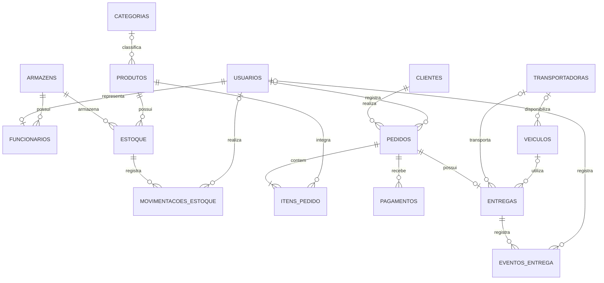

# OmniLog Hub — Diagrama Entidade-Relacionamento

O diagrama representa as principais entidades e seus relacionamentos.
O modelo contém 15 entidades.

## Relacionamentos principais

- Um cliente pode realizar vários pedidos.
- Um pedido possui um ou mais itens.
- Um produto pode aparecer em vários itens de pedidos.
- Um produto pode estar armazenado em vários armazéns.
- O estoque relaciona produtos e armazéns.
- Uma entrega pertence a um pedido nesta versão do sistema.
- Uma entrega pode possuir vários eventos de acompanhamento.
- Uma transportadora pode disponibilizar vários veículos.

## Observação
O diagrama deve ser comparado com o script `database/scripts/01_schema.sql`.
A cardinalidade de pedidos e itens considera pedidos válidos com pelo menos um item, regra que também deve ser garantida pela aplicação.
